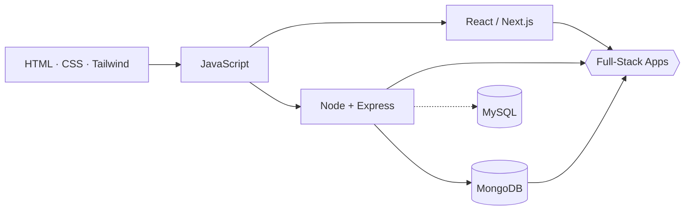
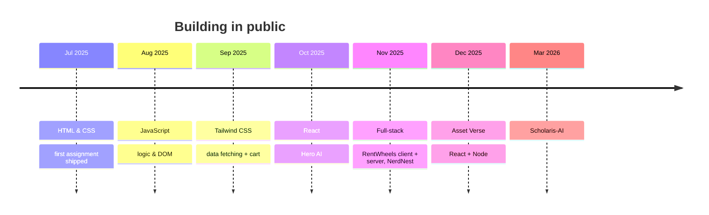

<!-- ═══════════════ HEADER ═══════════════ -->
<div align="center">


<a href="https://github.com/ipe-asmaul">
  
</a>

<br/><br/>

[](https://www.linkedin.com/in/md-asmaul-hossin/)
[](https://github.com/ipe-asmaul)
[](https://github.com/ipe-asmaul?tab=repositories)
[](https://github.com/ipe-asmaul?tab=followers)


</div>

---

## `> whoami`

```js
const asmaul = {
  github   : "ipe-asmaul",
  location : "Bangladesh",
  student  : "BUET",
  role     : "Full-stack web developer",
  stack    : ["MongoDB", "Express", "React", "Node.js"],
  styling  : ["Tailwind CSS", "DaisyUI", "CSS3", "HTML5"],
  level    : { javascript: "advanced", c: "~70%", htmlCss: "expert-ish" },
  mindset  : "Learn fast, build in public, polish everything",
};
```

---

## `> ls ./skills`

### ▍ Languages
<div align="center">


</div>

### ▍ Frontend
<div align="center">


</div>

### ▍ Backend
<div align="center">


</div>

### ▍ Databases
<div align="center">


-000000?style=for-the-badge&logo=mysql&logoColor=4479A1)

</div>

### ▍ Deploy & Tools
<div align="center">


</div>

---

## `> skill --meter`

```text
JavaScript   ██████████████████░░  90%   advanced
HTML / CSS   ███████████████████░  95%
Tailwind CSS █████████████████░░░  85%
React        ███████████████░░░░░  75%
Node.js      █████████████░░░░░░░  65%
MongoDB      █████████████░░░░░░░  65%
C            ██████████████░░░░░░  70%
MySQL        ██████░░░░░░░░░░░░░░  30%   learning
```

---

## `> architecture`



---

## `> ls ./projects`

| Project | What it is | Stack | Links |
|:--------|:-----------|:------|:------|
| **RentWheels** | Car rental SPA with authentication & authorization, dynamic search, Swiper sliders and Lottie animations | React · DaisyUI · Node | [Live](https://rent-wheel.netlify.app/) · [Client](https://github.com/ipe-asmaul/RentWheels-CarRentalWebsite-Client) · [Server](https://github.com/ipe-asmaul/RentWheels-CarRentalWebsite-Server) |
| **Hero AI** | App-installing site with dynamic search and localStorage-powered installs | React · Tailwind | [Live](https://my-hero-io-app.netlify.app/) · [Code](https://github.com/ipe-asmaul/hero-ai) |
| **Green Earth** | Tree-shopping site with API data fetching and a working cart | JavaScript · Tailwind | [Live](https://ipe-asmaul.github.io/ph-6th-assignment-green-earth/) · [Code](https://github.com/ipe-asmaul/ph-6th-assignment-green-earth) |
| **Asset Verse** | Full-stack app with a React (Vite) client and a dedicated Node server | React · Vite · Node | [Client](https://github.com/ipe-asmaul/Asset-Verse) · [Server](https://github.com/ipe-asmaul/Asset-Verse-Server) |
| **NerdNest** | Next.js application | Next.js · JavaScript | [Code](https://github.com/ipe-asmaul/NerdNest) |

<div align="center">

[](https://github.com/ipe-asmaul?tab=repositories)

</div>

---

## `> git log --journey`



---

## `> git stats`

<div align="center">


<br/>


</div>

---

## `> now`

```bash
building    →  full-stack MERN projects
sharpening  →  advanced JavaScript, React patterns, Node APIs
learning    →  MySQL & deeper backend design
open to     →  collaborations, internships, and cool ideas
```

---

## `> contact`

<div align="center">

[](https://www.linkedin.com/in/md-asmaul-hossin/)
[](https://github.com/ipe-asmaul)

<br/>

<sub>`while (alive) { learn(); build(); ship(); }`</sub>


</div>
