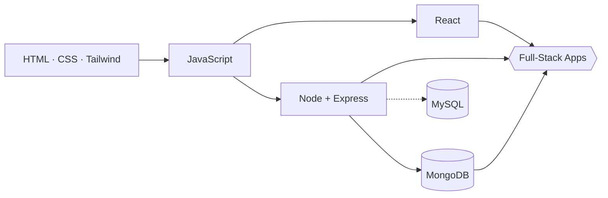

<!-- ═══════════════ HEADER ═══════════════ -->
<div align="center">


<a href="https://git.io/typing-svg">
  
</a>

<br/><br/>

[](https://www.linkedin.com/in/md-asmaul-hossin/)
[](https://github.com/YOUR_USERNAME)
[](https://github.com/YOUR_USERNAME?tab=repositories)
[](https://github.com/YOUR_USERNAME?tab=followers)


</div>

---

## `> whoami`

```js
const asmaul = {
  location : "Bangladesh",
  student  : "BUET",
  role     : "Full-stack web developer",
  stack    : ["MongoDB", "Express", "React", "Node.js"],
  styling  : ["Tailwind CSS", "CSS3", "HTML5"],
  level    : { javascript: "advanced", c: "~70%", htmlCss: "expert-ish" },
  mindset  : "Learn fast, build in public, polish everything",
};
```

---

## `> ls ./skills`

### ▍ Languages
<div align="center">


</div>

### ▍ Frontend
<div align="center">


</div>

### ▍ Backend
<div align="center">


</div>

### ▍ Databases
<div align="center">


-000000?style=for-the-badge&logo=mysql&logoColor=4479A1)

</div>

---

## `> skill --meter`

```text
JavaScript   ██████████████████░░  90%   advanced
HTML / CSS   ███████████████████░  95%
Tailwind CSS █████████████████░░░  85%
React        ██████████████░░░░░░  70%
Node.js      █████████████░░░░░░░  65%
MongoDB      █████████████░░░░░░░  65%
C            ██████████████░░░░░░  70%
MySQL        ██████░░░░░░░░░░░░░░  30%   learning
```

---

## `> architecture`



---

## `> git stats`

<div align="center">


<br/>


<br/>


</div>

---

## `> ls ./projects`

<!-- Replace each REPO_NAME with your real repository name so the links work -->

| Project | Stack | Link |
|:--------|:------|:-----|
| **Eid Greeting Card App** — five templates, shareable links | Next.js · MongoDB · Tailwind | [`repo →`](https://github.com/YOUR_USERNAME/REPO_NAME) |
| **World Cup Fan Card Generator** — pack-opening reveal animation | HTML · CSS · JavaScript | [`repo →`](https://github.com/YOUR_USERNAME/REPO_NAME) |
| **Interactive Whiteboard** — shape recognition | JavaScript · Canvas | [`repo →`](https://github.com/YOUR_USERNAME/REPO_NAME) |
| **BUET IPE Archive** — single-page app with admin panel | JavaScript · CSS | [`repo →`](https://github.com/YOUR_USERNAME/REPO_NAME) |

<div align="center">

[](https://github.com/YOUR_USERNAME?tab=repositories)

</div>

---

## `> now`

```bash
building    →  full-stack MERN projects
sharpening  →  advanced JavaScript, React patterns, Node APIs
learning    →  MySQL & deeper backend design
open to     →  collaborations, internships, and cool ideas
```

---

## `> contact`

<div align="center">

[](https://www.linkedin.com/in/md-asmaul-hossin/)

<br/>

<sub>`while (alive) { learn(); build(); ship(); }`</sub>


</div>
