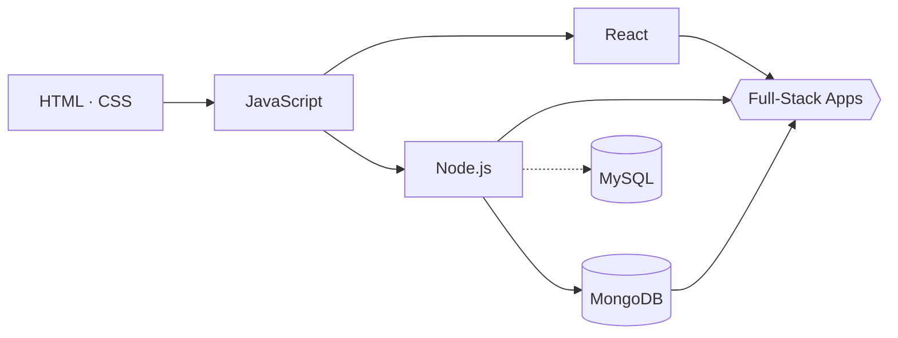

<!-- ═══════════════ HEADER ═══════════════ -->
<div align="center">


<a href="https://git.io/typing-svg">
  
</a>

<br/>


</div>

---

## ⌬ `whoami`

```js
const asmaul = {
  university : "BUET — Bangladesh University of Engineering and Technology",
  major      : "Industrial & Production Engineering (IPE)",
  focus      : ["Web Development", "Operations Research", "Supply Chain", "Data"],
  stack      : "MERN (MongoDB · Express/Node · React)",
  currently  : "Merging engineering thinking with software skills",
  lookingFor : "Projects, collaborations & opportunities that blend both worlds",
};
```

---

## ◈ Tech Dashboard

### ▍ 01 — Core Languages

<div align="center">


</div>

### ▍ 02 — Frontend

<div align="center">


</div>

### ▍ 03 — Backend

<div align="center">


</div>

### ▍ 04 — Databases

<div align="center">


-4479A1?style=for-the-badge&logo=mysql&logoColor=white)

</div>

### ▍ 05 — Engineering Toolkit (IPE)

<div align="center">


</div>

---

## ◈ Skill Meter

| Skill | Level | Rating |
|:------|:------|:-------|
| **JavaScript** | `▰▰▰▰▰▰▰▱▱▱` | 70% |
| **React** | `▰▰▰▰▰▰▱▱▱▱` | 60% |
| **Node.js** | `▰▰▰▰▰▰▱▱▱▱` | 60% |
| **MongoDB** | `▰▰▰▰▰▰▱▱▱▱` | 60% |
| **HTML / CSS** | `▰▰▰▰▰▰▰▰▱▱` | 80% |
| **C** | `▰▰▰▰▰▰▱▱▱▱` | 60% |
| **MySQL** | `▰▰▰▱▱▱▱▱▱▱` | 30% — *learning* |

> 🔧 Adjust the bars to match how you honestly rate yourself.

---

## ◈ Stack Map



---

## ◈ GitHub Analytics

<div align="center">


<br/>


<br/>


</div>

---

## ◈ Featured Projects

<!-- Replace REPO_NAME with your repository names -->

<div align="center">

<a href="https://github.com/YOUR_USERNAME/REPO_NAME_1">
  
</a>
<a href="https://github.com/YOUR_USERNAME/REPO_NAME_2">
  
</a>

</div>

---

## ◈ Currently

| | |
|:--|:--|
| 🎓 **Studying** | Industrial & Production Engineering at BUET |
| 🔭 **Exploring** | Data analysis, operations research, and supply chain optimization |
| 🛠️ **Building** | Full-stack projects with the MERN stack |
| 📚 **Learning** | MySQL & deeper backend design |
| 🎯 **Goal** | Roles at the intersection of operations, supply chain, and tech |

---

## ◈ Connect

<div align="center">

[](https://linkedin.com/in/YOUR_LINKEDIN)
[](mailto:YOUR_EMAIL)
[](https://YOUR_PORTFOLIO)

<br/><br/>

*"An engineer optimizes systems — whether they're factories or codebases."*


</div>
